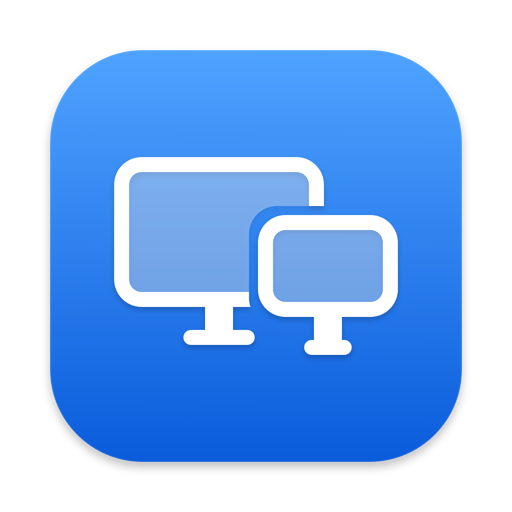

<p align="center">
  
</p>

<h1 align="center">Unplug</h1>

<p align="center">
  <strong>Turn external displays off from the menu bar — like pulling the cable, without pulling the cable.</strong>
</p>

<p align="center">
  <a href="https://github.com/iltekin/unplug/releases/latest"></a>
  
  
  <a href="LICENSE"></a>
</p>

<p align="center">
  <a href="https://iltekin.github.io/unplug/">Website</a> ·
  <a href="https://github.com/iltekin/unplug/releases/latest">Download</a> ·
  <a href="#install">Install with Homebrew</a>
</p>

---

Unplug does one thing. It lives in your menu bar and gives every connected external display an on/off switch.

When you switch a display **off**, macOS stops sending it a signal, exactly as if you had pulled the cable: your windows move to the remaining screens and the monitor goes to "No Signal". Switch it back **on** and it returns where it was.

It's useful when you want to focus on one screen, hand a monitor to someone else, watch something on the built-in screen only, or stop a second display from waking up without crawling behind the desk.

## Features

- **One switch per external display.** Real disconnect, not a black overlay or a dimmed screen.
- **Your built-in screen always stays on**, so unplugging a cable can never leave you without a screen.
- **The last active display can't be turned off**, for example with the lid closed.
- **Survives restarts gracefully.** Displays you turned off come back after you log out or restart.
- **Launches at login** and stays out of your way: no Dock icon, no windows.
- **Universal binary** for Apple Silicon and Intel Macs.
- **English and Turkish**, following your system language.
- **Signed and notarized** by Apple, so it opens without Gatekeeper warnings.

## Install

### Homebrew

```bash
brew install --cask iltekin/tap/unplug
```

### Manual

Download `Unplug-x.y.z.zip` from the [latest release](https://github.com/iltekin/unplug/releases/latest), unzip it and move **Unplug.app** to your Applications folder.

Requires macOS 13 Ventura or later.

## Usage

Click the two-displays icon in the menu bar and flip the switch next to a display. That's it.

To stop Unplug from launching at login, remove it in **System Settings → General → Login Items**.

## How it works

Unplug uses the private CoreGraphics function `CGSConfigureDisplayEnabled`, the same mechanism other display utilities use to disconnect a display in software. Changes are applied for the current session only, so a restart always brings every display back.

Because it relies on a private API, Unplug can't be distributed through the Mac App Store. It's signed with a Developer ID and notarized by Apple instead.

## Build from source

Only the Xcode Command Line Tools are needed (`xcode-select --install`).

```bash
git clone https://github.com/iltekin/unplug.git
cd unplug
./build.sh
open build/Unplug.app
```

The app icon is generated from code. To regenerate it after a change:

```bash
swift scripts/make-icon.swift Resources/AppIcon.icns
```

## Releasing

```bash
./release.sh 1.0.0
```

This builds a universal app, signs it with the Developer ID certificate, notarizes and staples it, zips it, and writes `packaging/unplug.rb` with the right checksum. Then:

1. Create a GitHub release tagged `v1.0.0` with the zip attached.
2. Copy `packaging/unplug.rb` to `Casks/unplug.rb` in [iltekin/homebrew-tap](https://github.com/iltekin/homebrew-tap).

Notarization expects a notarytool keychain profile named `unplug-notary` (see `release.sh`).

## License

[MIT](LICENSE) © 2026 Sezer Iltekin
